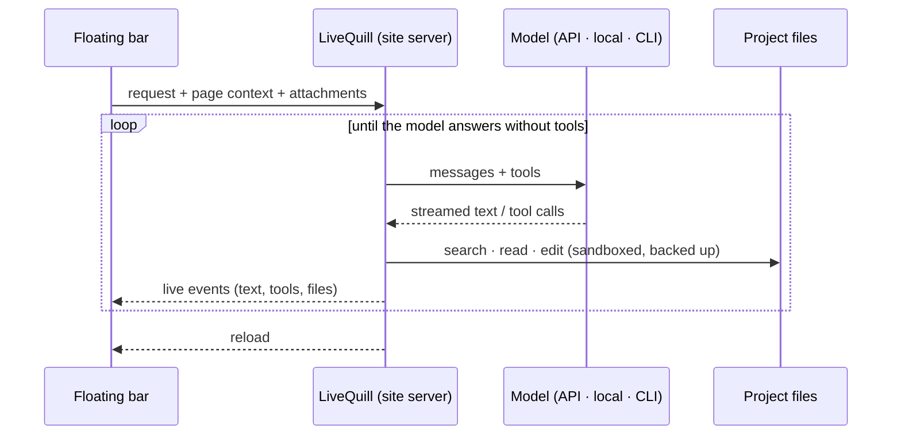

# Contributing to LiveQuill

Thanks for taking the time to contribute! Bug reports, new provider adapters, themes and translations are all welcome.

## Ground rules

- **Zero runtime dependencies.** LiveQuill only uses the Python standard library (3.10+), plus plain JavaScript and CSS in the browser. Please do not add packages.
- **Security first.** API keys must never reach the browser or the logs. File access must go through `Project.resolve()`. New `/__lq/` routes must check the session token and the origin.
- **No real network calls in tests.** Use `tests/helpers.FakeTransport` to replay provider responses.
- Match the surrounding style: small functions, short comments that explain *why*, no reformatting of unrelated code.

## Getting started

```bash
git clone https://github.com/Ybucaille/livequill.git
cd livequill
python3 -m unittest discover -s tests
node tests/e2e/browser.mjs        # real browser run (needs Chrome or Chromium)
./bin/livequill          # dashboard; add any local project as a site
```

Packaging and the installer:

```bash
python3 scripts/build-pyz.py                          # dist/livequill.pyz, the file install.sh downloads
scripts/test-install.sh debian:12 'apt-get update -qq && apt-get install -y -qq python3'   # install.sh in a clean container (Docker)
scripts/test-install.sh --host                        # install.sh on this machine, in a temporary HOME
```

Releases are automated: bump `version` in `pyproject.toml` and `livequill/__init__.py`, merge, then push a tag `vX.Y.Z`. The release workflow builds the wheel, the sdist and `livequill.pyz`, publishes the GitHub release, and publishes to PyPI.

## How it works



The dashboard runs on one port and each site on its own, so every site has its own origin, history and bar preferences. The bar is added to HTML pages while they are served, never written to disk.

```
bin/livequill     launcher (no install needed)
install.sh        official installer (downloads livequill.pyz from the latest release)
livequill/
  cli.py          command line
  server.py       dashboard, per-site servers (folder or proxy), script injection, API, live reload, i18n
  agent.py        agent loop, tools, text fallback, page context, history
  sandbox.py      locked-down paths, file tools, backups, undo and versions
  scaffold.py     new sites from templates
  config.py       providers, sites and settings (chmod 600), secret masking
  adapters/       one adapter per provider family
  static/         the bar (overlay.js), setup and dashboard pages, shared look (theme.css, sky.js, ui.js, providers.js)
  templates/      starting points of the new-site wizard
site/             showcase website (GitHub Pages)
scripts/          demo recorder, .pyz builder, installer tests, JS syntax check
tests/            unit, integration and browser tests, network mocked
```

### Coding agents and desktop apps

LiveQuill drives Claude Code, Codex and Gemini CLI through their non-interactive mode (`claude -p`, `codex exec`, `gemini -p`). How each one is confined is described in [SECURITY.md](SECURITY.md#coding-agents).

When the CLI is not installed, LiveQuill uses the copy shipped with the desktop app, with the account the app is signed in with. An installed CLI always takes priority, and the newest app version is picked every time the app updates itself. The macOS locations follow the same layout as Linux but have not been tested on a real Mac yet.

| App | Where LiveQuill looks |
|---|---|
| Claude Desktop | `~/.config/Claude/claude-code/<version>/…/claude` (Linux), `~/Library/Application Support/Claude/claude-code/<version>/…/claude` (macOS) |
| ChatGPT | `/usr/lib/chatgpt/resources/codex` (Linux), `/Applications/ChatGPT.app/Contents/Resources/codex` (macOS) |
| Codex app | `/Applications/Codex.app/Contents/Resources/codex` (macOS) |

## Common contributions

### A new provider

All provider-specific logic lives in one adapter. `livequill/adapters/base.py` documents the interface and the message format.

```python
from .base import Adapter, levels

class MyAdapter(Adapter):
    kind = 'my-provider'
    default_base = 'https://api.example.com'

    def list_models(self): ...                    # -> [{"id", "label", "meta"}]
    def caps(self, model, meta=None): ...         # -> {"tools", "vision", "effort", "fast"}
    def build_request(self, model, system, messages, tools, opts): ...  # pure, easy to test
    def parse_stream(self, lines): ...            # -> delta / thinking / part / stop events
```

1. Write an adapter in `livequill/adapters/`. Implement `list_models`, `caps`, `build_request` and `parse_stream` (see `base.py`). If the provider speaks the OpenAI Chat Completions API, one `compatible('name', 'https://…/v1')` line in `adapters/openai.py` is enough.
2. Register it in `KINDS` (`livequill/adapters/__init__.py`) with a label, a group, form fields and the URL of its key or download page.
3. Add tests to `tests/test_adapters.py`: one for request conversion (messages, images, tool calls, tool results) and one for stream parsing.

### A new theme

Add an entry to `THEMES` in `livequill/static/overlay.js`. Each entry has a `shape` (font, radius, sizes) and a `dark` and a `light` color set. It shows up in the palette menu automatically.

### A new language

The interface is written in English, and every visible text goes through `t()` (pages) or `tr()` (the bar). To add a language, create `livequill/static/i18n/<code>.json`, for example `fr.json`. It maps each English text to its translation, plus a `_name` key with the language's own name:

```json
{ "_name": "Français", "My sites": "Mes sites", "New site": "Nouveau site", "{n} file(s)": "{n} fichier(s)" }
```

Keep the `{placeholders}` as they are. Missing texts fall back to English. The language then appears in the language menu of the setup page and of **My sites**.

### A new site template

Add a folder to `livequill/templates/` with an `index.html` and its files, then register it in `TEMPLATES` (`livequill/scaffold.py`) with a name and a one-line description. `{{SITE_NAME}}` and `{{YEAR}}` are replaced when a site is created. Keep templates dependency-free (no build step, no CDN), so a beginner can open the folder and understand it.

## Pull requests

`main` is protected: every change goes through a pull request, needs a green CI and the maintainer's approval. CI for first-time and outside contributors starts once the maintainer approves the run.

1. Fork the repository and create a branch from `main` (`feat/…`, `fix/…`, `docs/…`).
2. Use [Conventional Commits](https://www.conventionalcommits.org/) messages: `feat(adapters): add Groq`, `fix(server): …`.
3. Run `python3 -m unittest discover -s tests` and try your change on a real site (`./bin/livequill ~/projects/some-site`).
4. Explain what changed and why in the pull request. Add a screenshot or a short recording for UI changes.

## Reporting bugs

Open an issue with:

- your OS and Python version;
- the provider and model;
- the mode (static or `--proxy`);
- what you expected and what happened.

Run with `LIVEQUILL_DEBUG=1` to print tracebacks, and **remove any API key** from what you paste.
