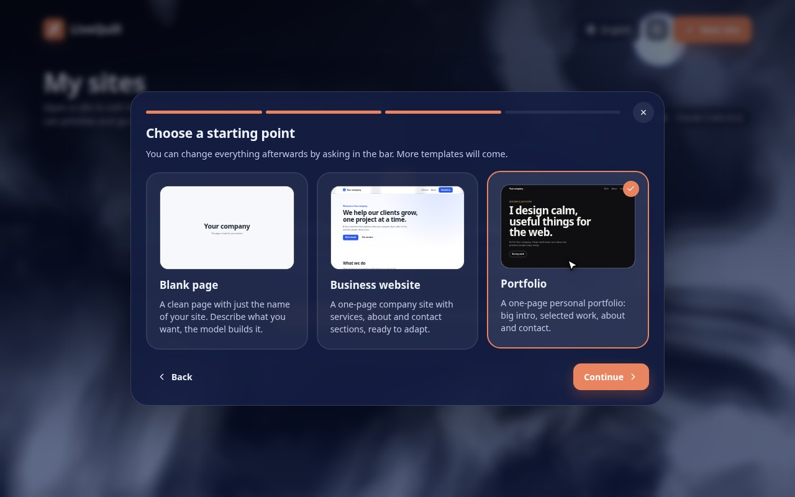

<div align="center">

# LiveQuill

**Edit your local website by asking.**<br>
A floating prompt bar for any local site: type a change, the model of your choice edits your real files, and the page reloads.

[](https://github.com/Ybucaille/livequill/actions/workflows/ci.yml)
[](https://pypi.org/project/livequill/)
[](https://www.python.org/)
[](pyproject.toml)
[](LICENSE)

[**Website**](https://ybucaille.github.io/livequill/) · [Install](#install) · [Models](#models) · [FAQ](#faq)

<a href="https://ybucaille.github.io/livequill/"></a>

<sub>A real, unedited first run with Claude Code (Sonnet): a portfolio from a template, then <i>“add a smooth scrolling engine with Lenis and GSAP”</i> and a quick color change. <a href="docs/demo.mp4">MP4 version</a>.</sub>

</div>

## Why LiveQuill

- **Ask on the page.** Describe the change on the page you are looking at. The model finds the code, edits it, and the page reloads.
- **Any model.** Cloud APIs, local models, or the coding agent you already use, even if you only have the Claude Desktop or ChatGPT app.
- **A new site in a minute.** A short wizard starts from a template or a blank page. No technical skills needed.
- **Nothing to lose.** Every request is a version you can preview and go back to, with one-click **Undo**. Zero dependencies, nothing added to your project.

## Install

Linux and macOS, with Python 3.10 or newer.

```bash
curl -fsSL https://ybucaille.github.io/livequill/install.sh | sh
```

No root, no git, no pip: the script checks and installs a single file, then creates the `livequill` command. If Python is missing, it tells you how to install it on your system.

<details>
<summary>Other ways to install, and uninstall</summary>

| | |
|---|---|
| **pipx / uv** | `pipx install livequill` or `uv tool install livequill` |
| **Single file** | Download `livequill.pyz` from a [release](https://github.com/Ybucaille/livequill/releases) and run `python3 livequill.pyz` |
| **From source** | `git clone https://github.com/Ybucaille/livequill.git && ./livequill/bin/livequill` |
| **Uninstall** | `curl -fsSL https://ybucaille.github.io/livequill/install.sh \| sh -s -- --uninstall` (or `pipx uninstall livequill`) |

</details>

## Update

Run the install command again: it replaces LiveQuill with the [latest release](https://github.com/Ybucaille/livequill/releases/latest) and keeps your settings and sites.

```bash
curl -fsSL https://ybucaille.github.io/livequill/install.sh | sh
```

With pipx or uv, run `pipx upgrade livequill` or `uv tool upgrade livequill`. From source, run `git pull`. Check your version with `livequill --version`, and restart LiveQuill after updating.

## Get started

```bash
livequill
```

1. **Choose a model.** The first launch opens the setup page. Click a model detected on your computer, or paste an API key.
2. **Create a site.** On **My sites**, click **New site**, pick a starting point (blank page, business website or portfolio), give it a name. Or add a site you already have.
3. **Ask.** The site opens with the floating bar. Try *“make the hero title red”*, watch it change, then click **Undo**.

<details>
<summary>Command-line options</summary>

| Option | Description |
|---|---|
| `FOLDER` | Add this folder to your sites (if needed) and open it. Without it, the dashboard opens. |
| `--proxy URL` | Serve `FOLDER` behind your dev server (Vite, Next, Astro…) instead of serving its files. |
| `--port N` | Dashboard port on `127.0.0.1` (default `8777`). Each site gets its own port after it. |
| `--config FILE` | Alternative config file (default `~/.config/livequill/config.json`). |
| `--no-open` | Do not open the browser. |

</details>

## Screenshots

<table>
<tr>
<td width="50%"><br><b>My sites.</b> All your projects, with a live thumbnail.</td>
<td width="50%"><br><b>New site.</b> Pick a starting point and a name.</td>
</tr>
<tr>
<td><br><b>Setup.</b> Detected models are one click away.</td>
<td><br><b>The bar.</b> Live answer, files changed, Undo.</td>
</tr>
</table>

## Models

| | Providers | What you need |
|---|---|---|
| **On your computer** | Ollama, LM Studio, llama.cpp, any OpenAI-compatible server | The app or server running. Free and private. |
| **In the cloud** | Anthropic, OpenAI, Google Gemini, Mistral, OpenRouter | An API key, pasted on the setup page or read from your environment. |
| **Coding agents** | Claude Code, Codex, Gemini CLI | The CLI, or just the **Claude Desktop** or **ChatGPT** app, signed in to your account. |

Switch models at any time from the bar. **Reasoning** and **Fast** appear when the model supports them.

<details>
<summary>Details per provider</summary>

| Provider | Notes |
|---|---|
| **Anthropic** | Key from [console.anthropic.com](https://console.anthropic.com/settings/keys). Effort levels on Claude 4.6+, **Fast** on Opus 5.5 / 5 / 4.8. |
| **OpenAI** | Key from [platform.openai.com](https://platform.openai.com/api-keys). `reasoning_effort` on o-series and gpt-5. |
| **Google Gemini** | Key from [aistudio.google.com](https://aistudio.google.com/apikey). Thinking budget (2.5) or level (3). |
| **Mistral** | Key from [console.mistral.ai](https://console.mistral.ai/api-keys). |
| **OpenRouter** | Key from [openrouter.ai/keys](https://openrouter.ai/keys). Capabilities are read for each model. |
| **Ollama** | `ollama serve`, then `ollama pull qwen2.5:7b-instruct` (any model that supports tools). |
| **LM Studio** | *Developer* tab → *Start server*. |
| **llama.cpp** | `llama-server -m model.gguf --jinja`. |
| **Other** | Any OpenAI-compatible server (vLLM, LocalAI, Jan, Groq, DeepSeek…): base URL, optional key, model name. |
| **Claude Code** | `claude` signed in, or the Claude Desktop app. Runs confined to the project, see [SECURITY.md](SECURITY.md#coding-agents). |
| **Codex** | `codex login`, or the ChatGPT or Codex app. Runs in its sandbox, but can read your whole disk: see [SECURITY.md](SECURITY.md#coding-agents). |
| **Gemini CLI** | `gemini` installed. *Experimental: not tested yet.* |

</details>

## Privacy and safety

- **Local only.** LiveQuill listens on `127.0.0.1` and checks a session token on every call.
- **Your keys stay on your computer.** They never reach the browser, and are masked in logs.
- **The model stays in your project.** No path outside it, no `.git` or `.env` files, no shell commands.
- **Every change is backed up** before it happens, so **Undo** always works, CLI agents included.

How each protection works is described in [SECURITY.md](SECURITY.md), where you can also report a vulnerability privately.

## FAQ

<details>
<summary><b>Does my code leave my computer?</b></summary>
<br>
Only with a cloud provider. With Ollama, LM Studio or llama.cpp, everything stays on your computer. With a cloud API, your request, the page context and the files the model reads are sent to that provider, like with any coding assistant.
</details>

<details>
<summary><b>Can I use it without an API key?</b></summary>
<br>
Yes. Install <a href="https://ollama.com/download">Ollama</a>, run <code>ollama pull qwen2.5:7b-instruct</code> (a 7B model or larger that supports tools works best), and pick it on the setup page. If you have Claude Code, Codex, or just the Claude Desktop or ChatGPT app, LiveQuill uses it with your existing sign-in.
</details>

<details>
<summary><b>What if the model breaks something?</b></summary>
<br>
Click <b>Undo</b> in the bar, as many times as you need. To go further back, open <b>History</b> (the clock button), choose the <b>Versions</b> tab, preview any earlier version, and click <b>Go back to this version</b>.
</details>

<details>
<summary><b>Does it work with React, Vue, Svelte or Next.js?</b></summary>
<br>
Yes. Keep your dev server running and add the site with its address, under <b>Advanced</b> (or run <code>livequill --proxy http://localhost:5173 ./my-app</code>). LiveQuill adds the bar to its pages and keeps hot reload working.
</details>

<details>
<summary><b>Where is my data stored?</b></summary>
<br>
Your models, keys and sites are in <code>~/.config/livequill/config.json</code>. New sites go to <code>~/LiveQuill/sites</code> by default. Each site gets a <code>.livequill/</code> folder with its backups and history. Uninstalling LiveQuill removes none of them: delete them yourself if you no longer need them.
</details>

<details>
<summary><b>Can I use it in another language?</b></summary>
<br>
The interface is in English for now, with a language menu ready for more. Adding a language is one translation file: see <a href="CONTRIBUTING.md#a-new-language">CONTRIBUTING.md</a>. The model itself answers in the language you write in.
</details>

## Roadmap

- **Dynamic sites** with a disposable demo database, so the model can work on data-driven pages safely.
- **More templates and languages** in the new-site wizard and the language menu.
- **Point and ask:** click an element on the page to scope the request to it.
- **Review before writing:** see the proposed changes and accept or reject them.

## Contributing

Contributions are welcome: providers, themes, templates, translations and fixes. Start with [CONTRIBUTING.md](CONTRIBUTING.md), which also explains how LiveQuill works inside.

## License

[MIT](LICENSE) © 2026 Ybucaille
