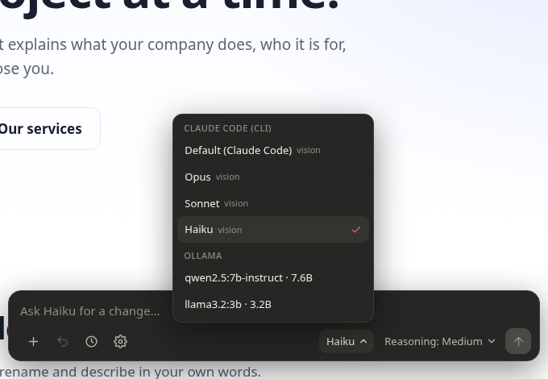
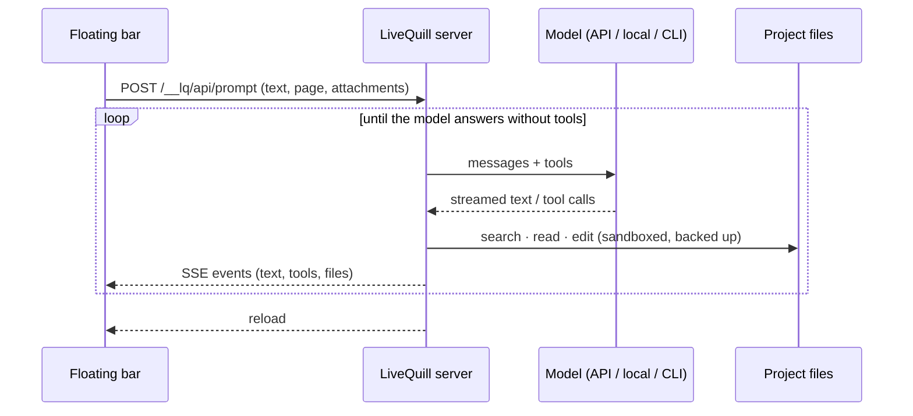

<div align="center">

# LiveQuill

**A floating prompt bar for any local website. Type a change, any model edits your real files, and the page reloads.**

[](https://www.python.org/)
[](pyproject.toml)
[](tests/)
[](LICENSE)
[](#providers)
[](CONTRIBUTING.md)

<a href="docs/demo.mp4"></a>

<sub>A real, unedited run: Claude Code (Haiku) edits <code>index.html</code>, the page reloads by itself, then <b>Undo</b> restores it, and the bar switches theme. <a href="docs/demo.mp4">Watch in MP4</a>.</sub>

</div>

---

## Why

Dev servers already reload when files change. The missing piece is asking for the change **from the page you are looking at**. LiveQuill adds a small prompt bar to any local site, sends your request and the page context to the model of your choice, runs the model's file edits inside the project folder, and reloads.

- **Any model**: Anthropic, OpenAI, Gemini, Mistral, OpenRouter, Ollama, LM Studio, llama.cpp, any OpenAI-compatible endpoint, or the Claude Code / Codex / Gemini CLIs you already use.
- **Its own agent loop**: no external session to keep open. The tool calls the model, runs the tools it asks for, and loops until the model is done.
- **Nothing to install in your project**: the bar is added while the page is served, never written to disk.
- **Undo**: every file is backed up before it is touched.
- **Zero dependencies**: plain Python 3 standard library.

## Contents

- [Quick start](#quick-start)
- [Features](#features)
- [Providers](#providers)
- [Static folder vs proxy mode](#static-folder-vs-proxy-mode)
- [Security](#security)
- [How it works](#how-it-works)
- [Adding a provider](#adding-a-provider)
- [Development](#development)
- [FAQ](#faq)
- [Contributing](#contributing)
- [License](#license)

## Quick start

```bash
git clone https://github.com/Ybucaille/livequill.git
cd livequill
./bin/livequill demo            # try it on the bundled demo page
```

The first launch opens the **setup page** at `http://127.0.0.1:8777/__setup`. Pick a provider, click **Test connection**, choose a default model, then **Open the site**.

```bash
./bin/livequill ./my-site                                    # serve a static folder
./bin/livequill --proxy http://localhost:5173 ./my-project   # sit in front of Vite, Next, Astro…
```

To make it available everywhere:

```bash
ln -s "$PWD/bin/livequill" ~/.local/bin/livequill
```

Or install it with pipx:

```bash
pipx install .
```

| Option | Description |
|---|---|
| `FOLDER` | Project to edit (default: current folder). |
| `--proxy URL` | Proxy an existing dev server instead of serving the folder. |
| `--port N` | Port on `127.0.0.1` (default `8777`, the next free one if it is taken). |
| `--config FILE` | Alternative config file (default `~/.config/livequill/config.json`). |
| `--no-open` | Do not open the browser. |

## Features

<table>
<tr>
<td width="50%"></td>
<td width="50%"></td>
</tr>
<tr>
<td><b>Live panel.</b> Streams the answer, the tools being called and the files changed. It survives the reload.</td>
<td><b>Setup page.</b> Each provider card shows <b>Available</b> (green, connection checked live), <b>Detected</b> (found on this machine, one click to enable) or what to do next, with a link to the provider's key or download page.</td>
</tr>
<tr>
<td></td>
<td></td>
</tr>
<tr>
<td><b>Every model in one menu</b>, grouped by provider. You can switch models without restarting. <b>Reasoning</b> and <b>Fast</b> controls only show up when the selected model supports them.</td>
<td><b>Themes.</b> Claude, ChatGPT, Gemini and Minimal, each in light and dark. They follow the system theme by default, or you can force one.</td>
</tr>
</table>

Also included:

- **Attachments**: + button, paste, or drag and drop (15 MB per file). Images are sent as vision input when the model supports it, text files are inlined, and other files can be copied into the project by the model.
- **Page context**: the current route (`pathname` + `hash`), the matching HTML file, the visible h1–h3 headings and the text you selected are sent with each request, so "the title" means what you see.
- **History per project**: previous requests are replayed as plain text, so the context survives a model switch. **New** starts over.
- **Undo** (↶): restores the files changed by the last request, and you can undo several times in a row. It also works for CLI agents.
- **Small-model friendly**: if a model cannot do tool calls, or writes them as plain text, livequill switches to a text protocol (`tool` JSON blocks and `SEARCH/REPLACE` edits). The search tool sees through HTML tags, and a model that stops silently gets one nudge to continue.
- The bar lives in a **Shadow DOM**: the site's CSS cannot break it, and its keystrokes do not trigger the site's shortcuts.

## Providers

| Provider | What you need | Notes |
|---|---|---|
| **Anthropic** | API key from [console.anthropic.com](https://console.anthropic.com/settings/keys) | Reasoning effort `low` → `max` on Claude 4.6+ models. **Fast** on Opus 5.5, Opus 5 and Opus 4.8. |
| **OpenAI** | API key from [platform.openai.com](https://platform.openai.com/api-keys) | `reasoning_effort` on o-series and gpt-5 models. |
| **Google Gemini** | API key from [aistudio.google.com](https://aistudio.google.com/apikey) | Thinking budget (2.5) or thinking level (3). |
| **Mistral** | API key from [console.mistral.ai](https://console.mistral.ai/api-keys) | Vision and tools read from the model list. |
| **OpenRouter** | API key from [openrouter.ai/keys](https://openrouter.ai/keys) | Tools, vision and reasoning read for each model. |
| **Ollama** | `ollama serve`, then `ollama pull qwen2.5:7b-instruct` | Detected on `127.0.0.1:11434`. Models come from `/api/tags`, capabilities from `/api/show`. `num_ctx` defaults to 16384. |
| **LM Studio** | *Developer* tab → *Start server* | `127.0.0.1:1234/v1` |
| **llama.cpp** | `llama-server -m model.gguf --jinja` | `127.0.0.1:8080/v1` (`--jinja` enables tool calls). |
| **Other** | Base URL (`…/v1`), optional key and model name | Any OpenAI-compatible server: vLLM, LocalAI, Jan, Groq, DeepSeek, a proxy… |
| **Claude Code** | `claude` on your `PATH`, logged in | Runs `claude -p` in the project with `acceptEdits`, **Bash and web tools disabled**. |
| **Codex** | `codex` on your `PATH`, logged in (`codex login`) | Runs `codex exec --sandbox workspace-write` in the project. |
| **Gemini CLI** | `gemini` on your `PATH` | `gemini -p … --approval-mode auto_edit`. *Untested: it was not installed on the development machine.* |

API keys already set in your environment (`ANTHROPIC_API_KEY`, `OPENAI_API_KEY`, `GEMINI_API_KEY`, `MISTRAL_API_KEY`, `OPENROUTER_API_KEY`) are detected. When you choose one, only the variable name is stored, never the key.

> [!TIP]
> **Local models:** pick a model that supports tools (`/api/show` should list `tools`), such as `qwen2.5`, `qwen3`, `llama3.1+` or `mistral`. On the bundled 220 KB demo page, `qwen2.5:7b-instruct` completes "make the title red" in three tool calls. 3B models get lost more often.

## Static folder vs proxy mode

| | Static folder | Proxy (`--proxy`) |
|---|---|---|
| Who serves the site | LiveQuill | Your dev server (Vite, Next…) |
| Where the bar is added | Every `.html` file served | Every `text/html` response |
| Reload | File watcher, plus a reload when each request finishes | Your HMR, plus a reload when each request finishes |
| WebSockets (HMR) | — | Passed through untouched |

In both modes the model edits the **folder given on the command line**.

## Security

- The server listens on **`127.0.0.1` only** and rejects foreign `Host` headers, which blocks DNS rebinding.
- `/__lq/*` routes require a **per-launch session token** (added to the page) and a **same-origin** request. `POST` bodies must be JSON. The setup page cannot be framed.
- **API keys never reach the browser**: not in `localStorage`, not in the HTML, not in API responses (which only expose `has_key`). They live in `~/.config/livequill/config.json`: the folder is `700`, the file is `600` and is created with those permissions from the start. Keys are masked in error messages, and the logs show neither request bodies nor tokens.
- File tools **refuse anything outside the project**: `..`, absolute paths, `~`, and symlinks that leave the folder. They also refuse `.git/`, `.env*`, `node_modules/` and `.livequill/`, and those paths are not served either.
- **A backup is made before every change**, in `<project>/.livequill/history/`. CLI agents write files themselves, so the project is snapshotted before the request and the changed files are recorded afterwards. `.livequill/` ignores itself (`*`), so your `.gitignore` stays untouched.
- **No shell commands** are run by API or local models in v1. Claude Code is launched with Bash disabled. Codex runs commands inside its own `workspace-write` sandbox: those are Codex's guarantees, not livequill's.

## How it works

```
bin/livequill     launcher (no install needed)
livequill/
  cli.py          command line
  server.py       HTTP: site (folder or proxy), script injection, /__lq/ API, reload (SSE)
  agent.py        agent loop, tools, text fallback, page context, history
  sandbox.py      locked-down paths, file tools, backups / undo, conversation
  config.py       user config (chmod 600), secret masking
  net.py          streaming urllib client (SSE / NDJSON)
  adapters/       one adapter per provider family
  static/         overlay.js (the bar, Shadow DOM) and setup.html
tests/            unit and integration tests (network mocked)
scripts/          record-demo.mjs: rebuilds docs/demo.mp4 with headless Chromium
demo/             demo page
```



## Adding a provider

All provider-specific logic lives in one adapter. `livequill/adapters/base.py` documents the interface and the internal message format.

```python
from .base import Adapter, levels

class MyAdapter(Adapter):
    kind = 'my-provider'
    default_base = 'https://api.example.com'

    def list_models(self):            # -> [{"id", "label", "meta"}]
        ...
    def caps(self, model, meta=None): # -> {"tools", "vision", "effort": levels('low', 'high') | None, "fast"}
        ...
    def build_request(self, model, system, messages, tools, opts):  # -> (method, url, headers, body), pure and testable
        ...
    def parse_stream(self, lines):    # stream lines -> delta / thinking / part / stop events
        ...
```

Then register it in `KINDS` (`livequill/adapters/__init__.py`) with its label, group (`cloud` / `local` / `cli`), form fields and key page URL. The setup page and the bar pick it up automatically. An **OpenAI-compatible** provider does not even need a class: one line with `compatible('name', 'https://…/v1')` in `adapters/openai.py` is enough.

## Development

```bash
python3 -m unittest discover -s tests     # 40 tests, about 3 s, no real network calls
```

The suite covers:

- path protection;
- script injection in static and proxy mode (against a fake dev server);
- route guards (token, origin, `Host`, JSON) and the absence of keys in every response;
- request conversion and stream parsing for every adapter;
- the agent loop: edit and undo, tool errors, text-mode fallback, tool calls written as text, nudge, cancel;
- snapshot-based undo for CLI agents.

To re-record the demo video, run a provider-backed instance, then the recorder (needs `chromium` and `ffmpeg`):

```bash
./bin/livequill demo --port 8792 --no-open &
node scripts/record-demo.mjs --url http://127.0.0.1:8792/ --model cli-claude::haiku --out docs/demo
```

## FAQ

<details>
<summary><b>Why the name LiveQuill?</b></summary>

A quill is the pen you write and correct a page with. With LiveQuill you write the change on the page itself, and the model rewrites the source **live**, while you watch. The name is short, provider-neutral, and easy to type as a command: `livequill`.
</details>

<details>
<summary><b>Does my code leave my machine?</b></summary>

Only if you choose a cloud provider. With Ollama, LM Studio or llama.cpp, everything stays local: the server listens on `127.0.0.1` and the model runs on your computer. With a cloud API, the request, the page context and the files the model reads are sent to that provider, as with any coding assistant.
</details>

<details>
<summary><b>Can I use it without an API key?</b></summary>

Yes. Install [Ollama](https://ollama.com/download), pull a model that supports tools (`ollama pull qwen2.5:7b-instruct`) and LiveQuill detects it on the setup page. If you already use Claude Code or Codex, LiveQuill can also delegate to them with your existing login.
</details>

<details>
<summary><b>Does it work with React, Vue, Svelte or Next.js?</b></summary>

Yes, with proxy mode: keep your dev server running and start `livequill --proxy http://localhost:5173 ./my-project`. LiveQuill adds the bar to the HTML responses and passes HMR WebSockets through, while the model edits your components in the project folder.
</details>

<details>
<summary><b>What if the model breaks something?</b></summary>

Click **Undo** (↶) in the bar: the files changed by the last request are restored from the backup taken before the edit. You can undo several requests in a row. Backups live in `<project>/.livequill/history/`, which ignores itself in git.
</details>

## Contributing

Contributions are welcome: new adapters, themes, bug fixes, translations (the UI is currently in French). Read [CONTRIBUTING.md](CONTRIBUTING.md) first. In short: keep the zero-dependency rule, add tests with mocked network calls, and run the suite before opening a pull request.

## License

[MIT](LICENSE) © 2026 Ybucaille
