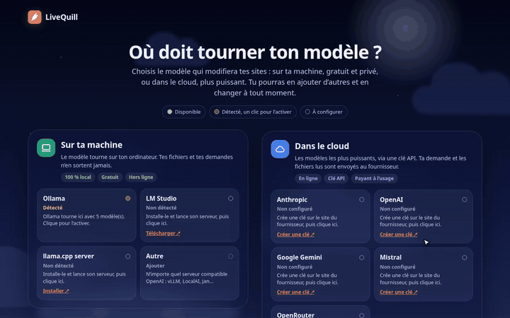
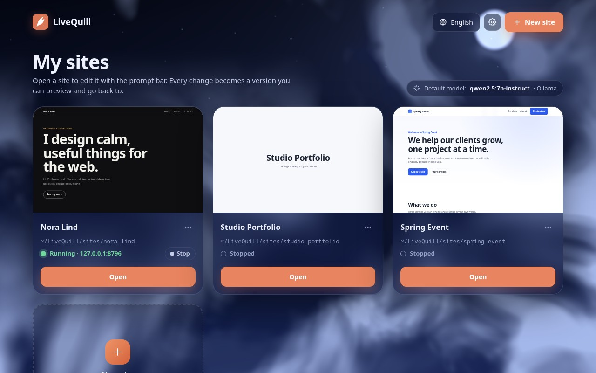
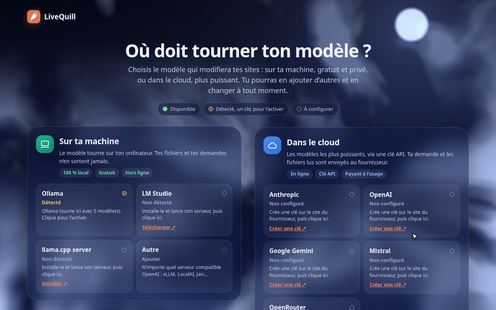
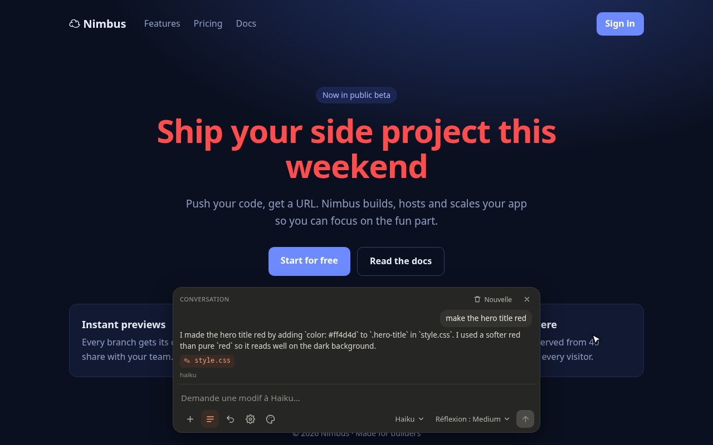
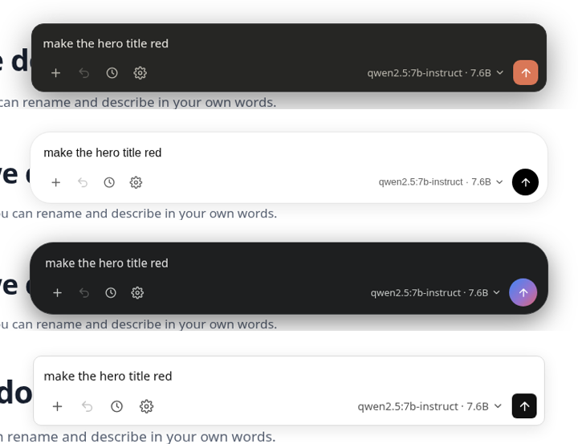
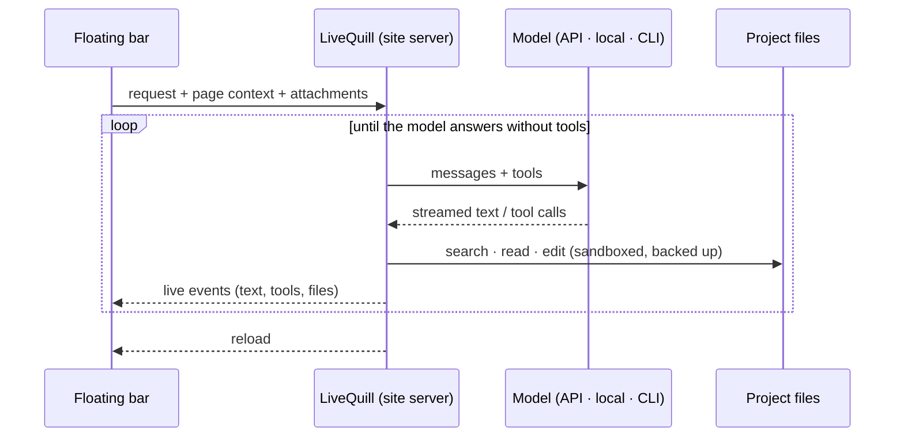

<div align="center">

# LiveQuill

**Edit your local website by asking.**<br>
A floating prompt bar for any local site: type a change, the model of your choice edits your real files, and the page reloads.

[](https://github.com/Ybucaille/livequill/actions/workflows/ci.yml)
[](https://github.com/Ybucaille/livequill/actions/workflows/codeql.yml)
[](https://www.python.org/)
[](pyproject.toml)
[](LICENSE)
[](CONTRIBUTING.md)

[**Website**](https://ybucaille.github.io/livequill/) · [Quick start](#quick-start) · [Providers](#providers) · [Roadmap](#roadmap) · [FAQ](#faq)

<a href="https://ybucaille.github.io/livequill/"></a>

<sub>A real, unedited first run: setup → add a site → “make the hero title red” → Undo → switch theme. <a href="docs/demo.mp4">MP4 version</a>.</sub>

</div>

## Highlights

- **Ask, don't dig.** Describe the change on the page you are looking at. The model finds the code, edits it, and the page reloads.
- **Any model.** Claude, GPT, Gemini, Mistral, OpenRouter, local models through Ollama, LM Studio or llama.cpp, any OpenAI-compatible server, or the Claude Code, Codex and Gemini CLIs you already use.
- **All your sites in one place.** A dashboard lists your projects. Each one is served as-is or behind your dev server (Vite, Next, Astro…).
- **Safe by default.** Sandboxed file tools, a backup before every edit, one-click **Undo**, and API keys that never reach the browser.
- **Nothing to install in your project.** The bar is added while pages are served, never written to disk. **Zero dependencies**: just Python.

## Quick start

You need **Python 3.10+**, nothing else. Tested on Linux and macOS (Windows is not tested yet).

```bash
git clone https://github.com/Ybucaille/livequill.git
cd livequill
./bin/livequill
```

Press <kbd>Ctrl</kbd>+<kbd>C</kbd> in the terminal to stop it.

1. **Setup.** The first launch opens the setup page. Pick a provider: paste an API key, or click a local model or CLI agent detected on your machine.
2. **Add a site.** You land on **Mes sites** (the interface is in French for now). Add a project folder, or the URL of your running dev server.
3. **Open it and ask.** The site opens with the floating bar. Try *“make the hero title red”*, watch it change, then click **Undo**.

Handy shortcuts:

```bash
./bin/livequill ~/projects/my-site                            # add this folder and open it
./bin/livequill --proxy http://localhost:5173 ~/projects/app   # same, behind your dev server
ln -s "$PWD/bin/livequill" ~/.local/bin/livequill              # make `livequill` available everywhere
```

Prefer an install? `pipx install git+https://github.com/Ybucaille/livequill.git` gives you the `livequill` command.

<details>
<summary>All command-line options</summary>

| Option | Description |
|---|---|
| `FOLDER` | Add this folder to your sites (if needed) and open it. Without it, the dashboard opens. |
| `--proxy URL` | Serve `FOLDER` behind an existing dev server instead of serving its files. |
| `--port N` | Dashboard port on `127.0.0.1` (default `8777`). Each site gets its own port after it. |
| `--config FILE` | Alternative config file (default `~/.config/livequill/config.json`). |
| `--no-open` | Do not open the browser. |

</details>

## Screenshots

<table>
<tr>
<td width="50%"></td>
<td width="50%"></td>
</tr>
<tr>
<td><b>Mes sites.</b> Add, edit, open or stop each project. Every site runs on its own port, with its own history.</td>
<td><b>Setup.</b> Each provider shows <b>Available</b> (connection checked live), <b>Detected</b> (one click away), or a link to get a key.</td>
</tr>
<tr>
<td></td>
<td></td>
</tr>
<tr>
<td><b>Live panel.</b> The answer streams in, with the tools called and the files changed. It survives the reload.</td>
<td><b>Themes.</b> Claude, ChatGPT, Gemini and Minimal, in light and dark, following your system.</td>
</tr>
</table>

## What the bar can do

| | |
|---|---|
| **Models** | Every configured model in one menu, grouped by provider. Switch without restarting. **Reasoning** and **Fast** only appear when the model supports them. |
| **Attachments** | + button, paste or drag and drop (15 MB per file). Images go in as vision input when supported, text files are inlined. |
| **Page context** | The current route, the matching HTML file, the visible headings and your text selection are sent along, so “the title” means what you see. |
| **History** | Earlier requests of the project are replayed as plain text, so context survives a model switch. **New** starts over. |
| **Undo** | Restores the files changed by the last request. Works several times in a row, and for CLI agents too. |
| **Small models** | No tool-call support? LiveQuill falls back to a text protocol (`tool` blocks and `SEARCH/REPLACE` edits) and nudges models that stop halfway. |

## Providers

| Provider | What you need |
|---|---|
| **Anthropic** | API key from [console.anthropic.com](https://console.anthropic.com/settings/keys). Effort levels on Claude 4.6+, **Fast** on Opus 5.5 / 5 / 4.8. |
| **OpenAI** | API key from [platform.openai.com](https://platform.openai.com/api-keys). `reasoning_effort` on o-series and gpt-5. |
| **Google Gemini** | API key from [aistudio.google.com](https://aistudio.google.com/apikey). Thinking budget (2.5) or level (3). |
| **Mistral** | API key from [console.mistral.ai](https://console.mistral.ai/api-keys). |
| **OpenRouter** | API key from [openrouter.ai/keys](https://openrouter.ai/keys). Capabilities are read for each model. |
| **Ollama** | `ollama serve`, then `ollama pull qwen2.5:7b-instruct` (any model listing `tools`). |
| **LM Studio** | *Developer* tab → *Start server*. |
| **llama.cpp** | `llama-server -m model.gguf --jinja`. |
| **Other** | Any OpenAI-compatible server (vLLM, LocalAI, Jan, Groq, DeepSeek…): base URL, optional key, model name. |
| **Claude Code** | `claude` installed and logged in. Runs with file edits allowed, **Bash and web tools disabled**. |
| **Codex** | `codex` installed and logged in (`codex login`). Runs in its `workspace-write` sandbox, where Codex may run shell commands. |
| **Gemini CLI** | `gemini` installed. *Experimental: not tested yet.* |

> [!TIP]
> Keys already in your environment (`ANTHROPIC_API_KEY`, `OPENAI_API_KEY`, `GEMINI_API_KEY`, `MISTRAL_API_KEY`, `OPENROUTER_API_KEY`) are detected. Only the variable name is stored, never the key.

## Security

LiveQuill lets a model touch your files, so the guard rails are on by default:

- **Local only.** Servers listen on `127.0.0.1`, reject foreign `Host` headers (DNS rebinding), and require a per-launch session token plus a same-origin request on every API call.
- **Keys stay server-side.** Stored in `~/.config/livequill/config.json` (folder `700`, file `600`), never sent to the browser, masked in error messages and logs.
- **Sandboxed tools.** No path outside the project, no symlink escape, no `.git/`, `.env*` or `node_modules/`, and no shell commands for API and local models.
- **Backups first.** Every file is saved to `<project>/.livequill/history/` before it changes. That folder ignores itself in git.

Found a vulnerability? Please report it privately: see [SECURITY.md](SECURITY.md).

## How it works



<details>
<summary>Project layout</summary>

```
bin/livequill     launcher (no install needed)
livequill/
  cli.py          command line
  server.py       dashboard, per-site servers (folder or proxy), script injection, API, live reload
  agent.py        agent loop, tools, text fallback, page context, history
  sandbox.py      locked-down paths, file tools, backups and undo
  config.py       providers and sites (chmod 600), secret masking
  adapters/       one adapter per provider family
  static/         the bar (overlay.js), setup page, dashboard
site/             showcase website (GitHub Pages)
scripts/          demo recorder, JS syntax check
tests/            unit and integration tests, network mocked
```

</details>

<details>
<summary>Adding a provider</summary>

All provider-specific logic lives in one adapter. `livequill/adapters/base.py` documents the interface and the message format.

```python
from .base import Adapter, levels

class MyAdapter(Adapter):
    kind = 'my-provider'
    default_base = 'https://api.example.com'

    def list_models(self): ...                    # -> [{"id", "label", "meta"}]
    def caps(self, model, meta=None): ...         # -> {"tools", "vision", "effort", "fast"}
    def build_request(self, model, system, messages, tools, opts): ...  # pure, easy to test
    def parse_stream(self, lines): ...            # -> delta / thinking / part / stop events
```

Register it in `KINDS` (`livequill/adapters/__init__.py`), and the setup page and the bar pick it up. An OpenAI-compatible provider is a one-liner: `compatible('name', 'https://…/v1')`.

</details>

## Roadmap

Ideas we would like to build next. Want one of them? Open an issue or a pull request.

- **Snapshot timeline.** Every agent edit already creates a backup. The next step is a timeline in the bar: browse the site's versions, preview any of them, and restore it in one click, not only the last change.
- **Point and ask.** Click an element on the page, like the browser inspector, to scope the request to it: “make *this* button bigger”.
- **Review before writing.** An optional mode that shows the proposed diff for each file and waits for you to accept or reject it before anything is saved.

## FAQ

### Why the name LiveQuill?

A quill is the pen you write and correct a page with. Here you write the change on the page itself, and the model rewrites the source live, while you watch. It is short, not tied to any model vendor, and easy to type as a command.

### Does my code leave my machine?

Only if you choose a cloud provider. With Ollama, LM Studio or llama.cpp, everything stays on your computer. With a cloud API, your request, the page context and the files the model reads are sent to that provider, like with any coding assistant.

### Can I use it without an API key?

Yes. Install [Ollama](https://ollama.com/download), pull a model that supports tools (`ollama pull qwen2.5:7b-instruct`), and pick it on the setup page. If you already use Claude Code or Codex, LiveQuill can also work through them with your existing login.

### Does it work with React, Vue, Svelte or Next.js?

Yes. Keep your dev server running and add the site with its URL (or run `livequill --proxy http://localhost:5173 ./my-app`). LiveQuill adds the bar to its pages and passes hot-reload WebSockets through, while the model edits your components.

### What if the model breaks something?

Click **Undo** in the bar. The files changed by the last request are restored from the backup taken just before the edit, and you can undo several requests in a row.

### Where is my data stored, and how do I uninstall?

Your providers, keys and sites live in `~/.config/livequill/config.json`. Each project gets a `.livequill/` folder with its backups and conversation history. To uninstall, delete the cloned folder (or `pipx uninstall livequill`), `~/.config/livequill/` and the `.livequill/` folders you no longer need.

### Which local model should I pick?

A 7B model or larger that supports tool calls, such as `qwen2.5:7b-instruct`, `qwen3` or `llama3.1`. Smaller models work for simple edits, but get lost more often in big files.

## Contributing

Contributions are welcome: adapters, themes, roadmap items, fixes and translations (the interface is currently in French). Start with [CONTRIBUTING.md](CONTRIBUTING.md). Every pull request runs the full CI (tests on Linux and macOS for Python 3.10 to 3.14, lint, secret scan, CodeQL) and is reviewed by the maintainer before merging.

```bash
python3 -m unittest discover -s tests     # about 5 s, no real network calls
```

## License

[MIT](LICENSE) © 2026 Ybucaille
